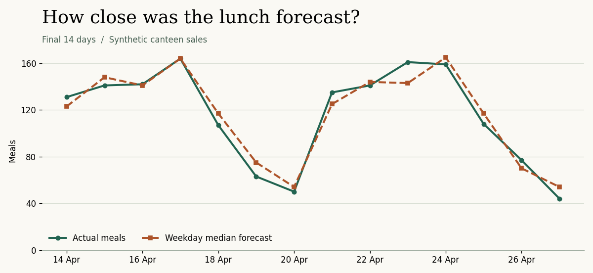

# Canteen Demand Forecast

How many lunches should a campus canteen expect tomorrow? This Python project takes daily meal counts, compares three forecasting rules, and produces a next-day estimate with a report showing how wrong earlier estimates were.



## Run the demo

Use Python 3.9 or newer. All dependencies come with Python. From the root of Learning_Tech-Lab, open `Projects/canteen-demand-forecast` and run the commands below.

```bash
python forecast.py --report report.html --predictions predictions.csv
python -m unittest -v
```

Open `report.html` to see the model comparison and daily values. To explore the results immediately, open the bundled [example report](examples/report.html) from your downloaded copy, or view the [prediction table](examples/predictions.csv) on GitHub.

## Results on the bundled sample

| Forecast rule | Validation MAE (meals) | Test MAE (meals) |
| --- | ---: | ---: |
| Yesterday’s count | 37.07 | 32.50 |
| Same day last week | 7.79 | 8.29 |
| Median of the previous four matching weekdays | 5.71 | 7.50 |

The weekday median wins on the validation period. On the final 14 days, its forecast differs from actual demand by **7.50 meals per day on average**. Its estimate for Monday, 28 April 2025 is **130 meals**. The 112-day sample is fictional, with a weekday pattern, random variation, and occasional event spikes. These results describe that sample.

## How the evaluation works

1. Sort the records by date. Keep the last 28 days for scoring and use earlier observations as history.
2. Produce a one-day-ahead forecast for each scoring day using only the previous 28 observed counts. Once a day ends, its actual count becomes available for the next forecast.
3. Pick the rule with the lowest mean absolute error (MAE) on the first 14 scoring days. A tie goes to the earlier rule in the table.
4. Measure that fixed rule on the final 14 days, then use it with the latest observations to forecast tomorrow.

The weekday model captures recurring weekly patterns. It cannot anticipate a new festival, exam break, or menu change from sales history alone.

## Try your own CSV

Supply at least 56 consecutive calendar days with one row per date. Use a verified zero on closed days. The loader flags gaps, duplicate dates, and negative counts.

```csv
date,meals
2025-01-06,122
2025-01-07,142
```

```bash
python forecast.py your_sales.csv --report your_report.html
```

The short CSV above shows the format. For a complete input, see [data/sample.csv](data/sample.csv). Recreate the bundled sample with `python data/generate.py`.
